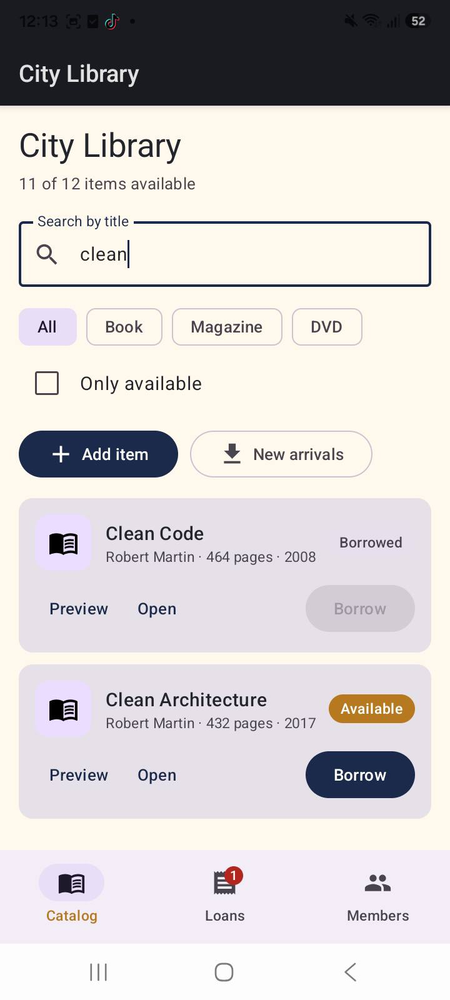
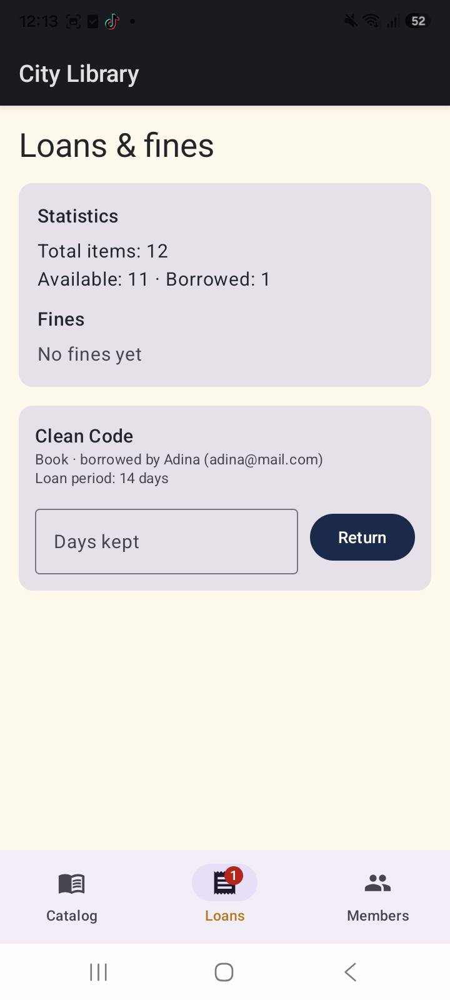

# LibraryApp — City Library (Midterm)

An Android library-management app built with Kotlin and Jetpack Compose.
Readers can browse the catalog, borrow and return items (late returns add a
fine), register members and load new arrivals from a simulated server.

Continues HW1 (domain models + `Library` logic) and HW2 (Compose UI +
`ViewModel`). Midterm Part 1 adds **Navigation Compose**, a **Members**
screen and lifecycle-aware state collection.

## Purpose

City Library helps a small library track inventory and loans without a
spreadsheet: staff see what is available, who has what, and which members
owe late fees.

## Features (meaningful)

1. **Catalog** — search by title, filter by type, show only available items;
   add books/magazines/DVDs; open an item detail screen; borrow with member
   selection (max 3 loans per member).
2. **Loans** — active loans list, return with “days kept”, automatic late
   fees by item type, library statistics.
3. **Members** — register readers, see each member’s active loans and fines.
4. **New arrivals** — coroutine-powered simulated server fetch
   (`Library.fetchNewArrivals()`).

## Screens (Navigation Compose)

| Route | Screen | Role |
|---|---|---|
| `catalog` | Catalog | Browse / search / filter / add / borrow |
| `loans` | Loans | Returns, statistics, fines |
| `members` | Members | Register members, loans & fines per person |
| `item/{itemId}` | Item detail | Full item info + borrow (nav argument) |

Bottom navigation switches the three main tabs and restores their scroll /
saved state. Opening an item stacks the detail screen (bottom bar hidden).

## Architecture

```
UI (Compose screens + reusable components)
        ↑ callbacks / StateFlow
LibraryViewModel  ←  StateFlow<LibraryUiState>
        ↓
model.Library + Book / Magazine / Dvd / Member / Loan
```

- **UI** only renders state and fires events (state hoisting via callbacks).
- **ViewModel** owns `Library`, runs coroutines in `viewModelScope`, exposes
  an immutable `LibraryUiState` through `StateFlow`.
- **Domain** stays pure Kotlin from HW1 (no Android dependencies).

State collection uses `collectAsStateWithLifecycle()` so the UI stops
observing when the Activity is not at least `STARTED`.

### `remember` / `rememberSaveable` / `ViewModel`

| Mechanism | Example in this app | Survives rotation? |
|---|---|---|
| `remember` | Expanded “Preview” on a catalog card; dialog open flags | No |
| `rememberSaveable` | Search text, type filter, “Only available”, days-kept fields | Yes (`Bundle`) |
| `ViewModel` + `StateFlow` | Catalog, members, loans, fines, added items | Yes (retained) |

## Tech stack

- Kotlin, Jetpack Compose, Material 3
- Navigation Compose
- `ViewModel` + `StateFlow` + `collectAsStateWithLifecycle`
- kotlinx.coroutines
- Gradle 9.6 / AGP 9.4 / compileSdk 37 / minSdk 26

## How to run

1. Open this folder in **Android Studio** (`File → Open`).
2. Wait for **Gradle Sync**.
3. Start an emulator or connect a phone with USB debugging.
4. Run the `app` configuration (**Run ▶**).

```bash
# Windows terminal
gradlew.bat assembleDebug
gradlew.bat installDebug
```

If Gradle fails on JDK version, keep JDK 17. This project pins
`org.gradle.java.home` in `gradle.properties` when a local JDK 17 path is set;
adjust or remove that line for your machine.

## Screenshots

Catalog:


Catalog with search / filter:



Loans (return + fines):


Members (register + loan counts):



## Project structure

```
app/src/main/java/com/adina/libraryapp/
├── MainActivity.kt
├── LibraryViewModel.kt
├── model/
│   ├── Library.kt
│   └── Models.kt
└── ui/
    ├── LibraryApp.kt          # NavHost + bottom bar + Snackbar
    ├── CatalogScreen.kt
    ├── LoansScreen.kt
    ├── MembersScreen.kt
    ├── ItemDetailScreen.kt
    ├── navigation/Routes.kt
    ├── theme/Theme.kt
    └── components/
        ├── LibraryItemCard.kt
        ├── FilterBar.kt
        ├── LoanCard.kt
        ├── MemberCard.kt
        ├── MemberPicker.kt
        └── Dialogs.kt
```
