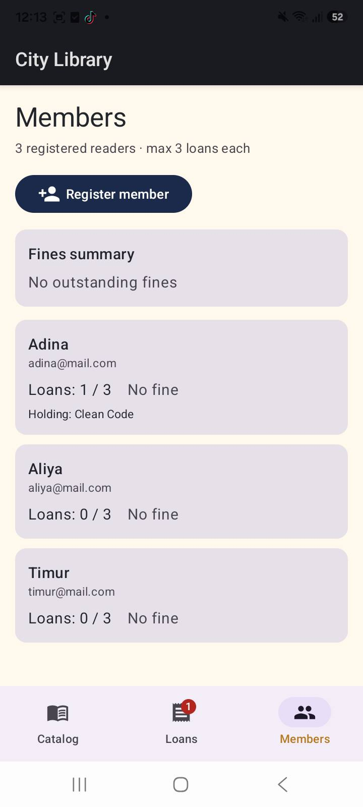
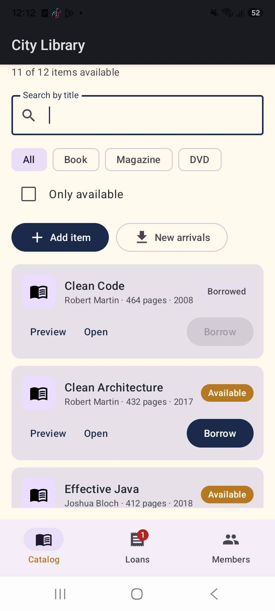

# LibraryApp — City Library (Android)

An Android application for managing a small library: books, magazines and DVDs.
Users can browse the catalog, search and filter items, borrow and return them
(late returns are charged a fee), add new items and load new arrivals from a
simulated server.

This project continues Homework 1: the console application's domain classes
(`Library`, `Book`, `Magazine`, `Dvd`, `Member`, `Loan`) were reused as-is and
put behind a Jetpack Compose UI and a `ViewModel`.

## Features

- **Catalog screen** — all items in a `LazyColumn` of Material 3 cards with
  type icon, details and availability status.
- **Search** by title, **filter** by type (`FilterChip`) and an
  "Only available" `Checkbox`.
- **Borrow** — pick a member in a dialog; the domain rules apply
  (max 3 items per member, already-borrowed items are rejected).
- **Return** — enter how many days the item was kept; late returns add a fine
  (Book $0.50/day, Magazine $0.25/day, DVD $1.00/day).
- **Add item** — dialog with type-specific fields (author/pages for books,
  issue for magazines, duration for DVDs).
- **New arrivals** — loads items with the suspend function
  `Library.fetchNewArrivals()` (coroutine, simulated 1.5 s server delay).
- **Loans screen** — active loans, statistics and fines per member.
- Results of every operation are shown in a Snackbar.

## Tech stack

- Kotlin, Jetpack Compose, Material 3
- `ViewModel` + `StateFlow` (UI state is an immutable snapshot)
- kotlinx.coroutines (`viewModelScope`, suspend functions)
- Gradle 9.6, Android Gradle Plugin 9.4, compileSdk 37, minSdk 26

## How to run

Requirements: Android Studio (latest), JDK 17, Android SDK 37.

1. Clone this repository and open the project folder in Android Studio
   (`File → Open`).
2. Wait for **Gradle Sync** to finish (dependencies are downloaded on first run).
3. Create an emulator (`Tools → Device Manager → Create Virtual Device`,
   e.g. Pixel with API 36/37) or connect a physical Android device with
   USB debugging enabled.
4. Select the `app` run configuration and press **Run ▶**.

From the terminal (with the Android SDK installed):

```bash
# Windows
gradlew.bat assembleDebug        # builds app/build/outputs/apk/debug/app-debug.apk
gradlew.bat installDebug         # installs on a running emulator / device
```

Note: the build runs the Gradle daemon on JDK 17 (`org.gradle.java.home` in
`gradle.properties`). If you do not have JDK 17, remove that line and set
JDK 17 in `Settings → Build, Execution, Deployment → Build Tools → Gradle`.

## How state works (rotation experiment)

The app demonstrates three kinds of state. Rotate the device
(or enable "Don't keep activities") to see the difference:

| Mechanism | Used for | Survives rotation? | Why |
|---|---|---|---|
| `remember` | expanded card ("Details") | No | Stored in the composition; the Activity and its composition are destroyed on recreation |
| `rememberSaveable` | search text, type filter, "Only available" checkbox, selected tab, "Days kept" fields | Yes | Written into the saved-state `Bundle` and restored after recreation |
| `ViewModel` | catalog, members, loans, fines, added items | Yes | The `ViewModel` is retained across Activity recreation and only cleared when the screen is finished for good |

Rule of thumb: `remember` — cheap transient UI state; `rememberSaveable` —
small user input that should also survive process death (anything that fits
in a `Bundle`); `ViewModel` — screen data and application logic that must not
be lost and does not belong in a `Bundle`.

## Project structure

```
app/src/main/java/com/adina/libraryapp/
├── MainActivity.kt          # entry point, setContent
├── LibraryViewModel.kt      # LibraryUiState + all user actions
├── model/
│   ├── Library.kt           # domain logic from HW1 (borrow/return/fines)
│   └── Models.kt            # Book, Magazine, Dvd, Member, Loan, LibraryResult
└── ui/
    ├── LibraryApp.kt        # Scaffold, bottom navigation, Snackbar
    ├── CatalogScreen.kt     # search, filter, catalog list, dialogs
    ├── LoansScreen.kt       # statistics, fines, returns
    ├── theme/Theme.kt       # Material 3 color scheme
    └── components/          # reusable composables:
        ├── LibraryItemCard.kt   # item card with status chip
        ├── FilterBar.kt         # search field + chips + checkbox
        ├── LoanCard.kt          # loan card with return form
        ├── MemberPicker.kt      # member radio list
        └── Dialogs.kt           # Borrow and Add-item dialogs
```

## Screenshots

Catalog with search and filter:



Borrow flow and loans with fines:


