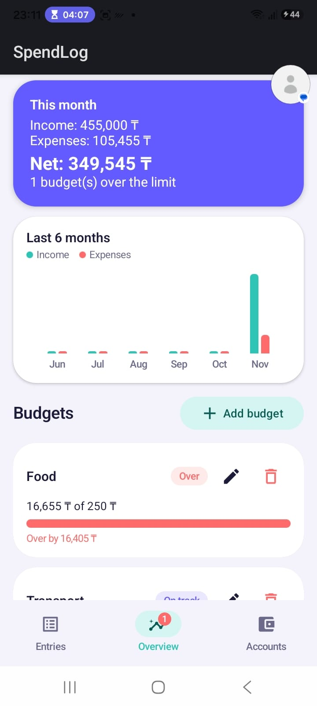
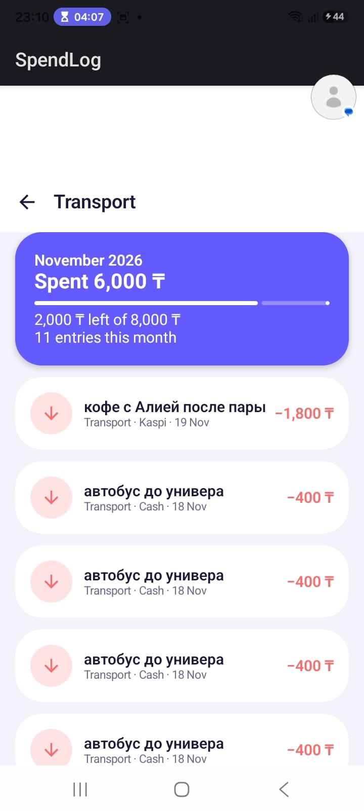
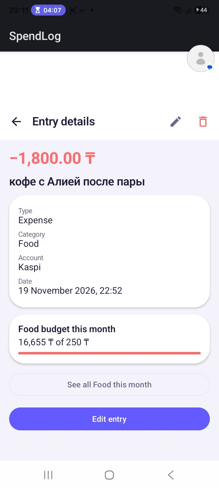
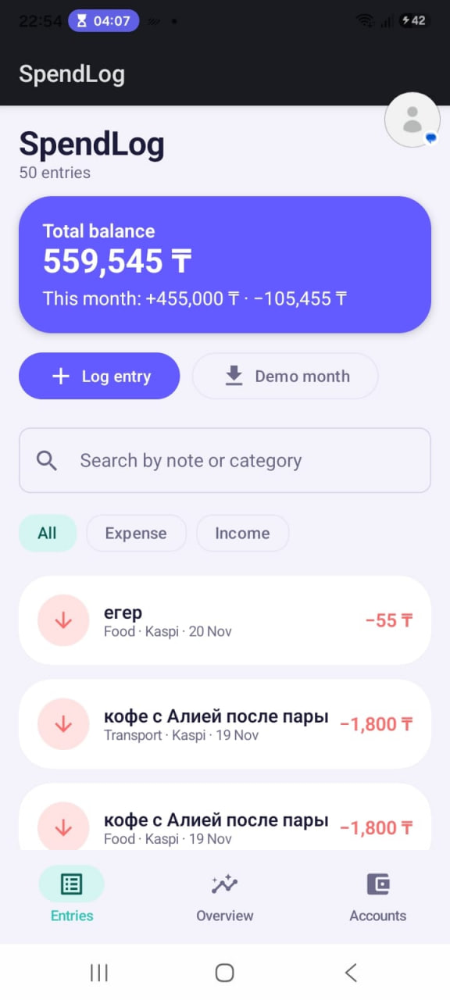
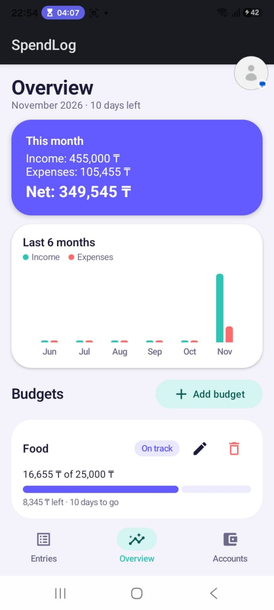
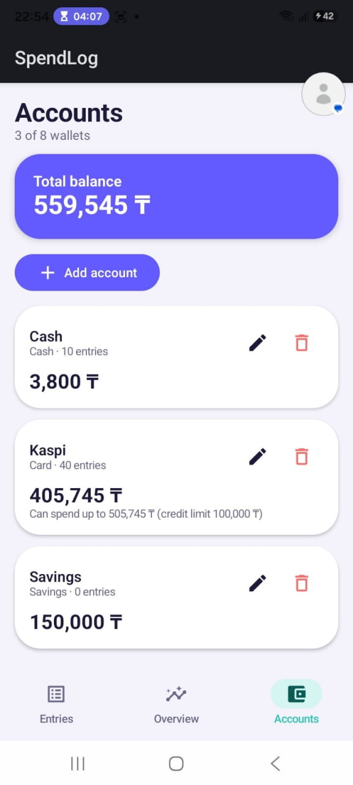

# SpendLog — personal expense & income tracker (Task 3)

An Android finance app built with Kotlin and Jetpack Compose.
You log what you spent or earned together with a short note about what you did,
track wallets (Cash / Card / Savings), set monthly category budgets and see
6-month history.

Continues earlier homework ideas (polymorphism, sealed results, rules, async
load, Navigation + StateFlow) and adds **Room local storage**, full **CRUD**,
form validation, empty states and an advanced feature: **monthly budgets +
undo on delete**.

## Purpose

SpendLog helps one person keep a personal money diary without a spreadsheet:
see total balance, this month’s income vs expenses, which categories are near
or over budget, and restore a deleted entry with Undo.

## Features

1. **Entries** — search by note/category, filter Expense / Income; add, open,
   edit and delete transactions; LazyColumn with stable keys; Demo month
   async load.
2. **Overview** — this month’s summary, last 6 months chart, monthly budgets
   with progress / near-limit / over-budget, category history screen.
3. **Accounts** — Cash, Card (with credit limit) and Savings; add / edit /
   delete (delete blocked if the account still has entries); max 8 accounts.
4. **Rules kept from earlier work** — Cash and Savings cannot go negative;
   Card can go down to minus its credit limit; `OperationResult` for success /
   error / not found.
5. **Persistence** — Room database; data survives app restart and configuration
   changes; UI updates automatically via Room `Flow`.

## Screens (Navigation Compose)

| Route | Screen | Role |
|---|---|---|
| `transactions` | Entries | List / search / filter / add / demo load |
| `overview` | Overview | Month stats, 6-month history, budgets CRUD |
| `accounts` | Accounts | Wallets CRUD |
| `transaction/{id}` | Entry detail | Full info, edit, delete with confirm |
| `transaction_form?…` | New / edit entry | Validated form (SavedStateHandle) |
| `category/{category}` | Category history | This month’s expenses in one category |

Bottom navigation switches the three main tabs and restores scroll / saved
state. Detail, form and category history hide the bottom bar.

## Architecture

```
UI (Compose screens + reusable components)
        ↑ collectAsStateWithLifecycle / callbacks
SpendLogViewModel + TransactionFormViewModel  ←  StateFlow
        ↓
FinanceRepository (OfflineFinanceRepository)
        ↓
Room (Account / Transaction / Budget entities + DAOs)
```

- **UI** only renders state and fires events (state hoisting via callbacks).
- **ViewModels** talk to the repository; form fields live in `SavedStateHandle`.
- **Repository** applies money rules and returns `OperationResult`.
- **Room** is the single source of truth; DAOs expose `Flow`.

Manual DI: `SpendLogApplication` → `AppContainer` → ViewModel factory.

### `remember` / `rememberSaveable` / `ViewModel` / Room

| Mechanism | Example in this app | Survives rotation? | Survives process death? |
|---|---|---|---|
| `remember` | Temporary UI flags | No | No |
| `rememberSaveable` | Search query, kind filter, dialog open | Yes | Yes (`Bundle`) |
| `ViewModel` + `StateFlow` | Lists, balances, budgets, snackbar | Yes (retained) | Reloaded from Room |
| Room DB | Accounts, transactions, budgets | Yes | Yes (on disk) |

## Tech stack

- Kotlin, Jetpack Compose, Material 3
- Navigation Compose
- `ViewModel` + `StateFlow` + `collectAsStateWithLifecycle`
- Room + KSP
- kotlinx.coroutines
- Gradle 9.6 / AGP 9.4 / compileSdk 37 / minSdk 26

## How to run

1. Open this folder in **Android Studio** (`File → Open`).
2. Wait for **Gradle Sync**.
3. Start an emulator or connect a phone with USB debugging.
4. Run the `app` configuration (**Run ▶**).

```bash
# Windows terminal
gradlew.bat assembleDebug
gradlew.bat installDebug
```

If Gradle fails on JDK version, keep JDK 17. This project pins
`org.gradle.java.home` in `gradle.properties` when a local JDK 17 path is set;
adjust or remove that line for your machine.

## Screenshots

### Additional feature — monthly budgets

Overview with over-budget alert (Food over limit, 6-month history, badge on tab):



Category history (month spend vs budget + entries for Transport):



Entry details with linked category budget:



### Main screens

Entries (list, balance, search / filter):



Overview (month summary, budgets on track):



Accounts (Cash / Card / Savings):



## Project structure

```
app/src/main/java/com/adina/spendlog/
├── MainActivity.kt
├── SpendLogApplication.kt
├── data/
│   ├── AppContainer.kt
│   ├── Mappers.kt
│   ├── local/
│   │   ├── Entities.kt
│   │   ├── Daos.kt
│   │   └── SpendLogDatabase.kt
│   └── repository/
│       ├── FinanceRepository.kt
│       └── OfflineFinanceRepository.kt
├── model/
│   ├── Models.kt
│   ├── FinanceRules.kt
│   └── Validation.kt
└── ui/
    ├── SpendLogApp.kt
    ├── TransactionsScreen.kt
    ├── TransactionDetailScreen.kt
    ├── TransactionFormScreen.kt
    ├── OverviewScreen.kt
    ├── CategoryHistoryScreen.kt
    ├── AccountsScreen.kt
    ├── navigation/Routes.kt
    ├── theme/Theme.kt
    ├── viewmodel/
    │   ├── AppViewModelProvider.kt
    │   ├── SpendLogViewModel.kt
    │   └── TransactionFormViewModel.kt
    └── components/
        ├── EmptyState.kt
        ├── FilterBar.kt
        ├── ChoiceChipRow.kt
        ├── HeroCard.kt
        ├── TransactionCard.kt
        ├── AccountCard.kt
        ├── AccountPicker.kt
        ├── BudgetCard.kt
        ├── MonthHistoryCard.kt
        └── Dialogs.kt
```
